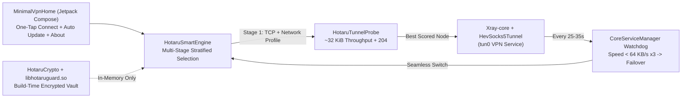

# معماری کلاینت اندروید و طراحی رابط کاربری HotaruNet

🌐 **زبان:** [🇬🇧 English](ARCHITECTURE.md) | **🇮🇷 فارسی (Persian)**

---

## ۱. جریان کلی عملکرد در اپلیکیشن اندروید

## ۲. ماژول‌های کلیدی کلاینت (`V2rayNG/app/src/main/`)

- **`ui/main/MinimalVpnHome.kt`**: رابط کاربری تک‌صفحه‌ای با تم Cyber-Anime (Jetpack Compose)، دکمهٔ اتصال نئونی، شمارندهٔ ترافیک لحظه‌ای، تغییر آنی زبان (`FA / EN`)، پاپ‌آپ بررسی نسخه جدید (`HotaruUpdateDialog`)، راهنمای یک‌بارهٔ اولین اتصال (`HotaruFirstConnectDialog`) و بخش درباره ما (`HotaruAboutDialog`).
- **`handler/HotaruSmartEngine.kt`**: تشخیص نوع شبکه کاربر (دیتا یا وای‌فای)، اولویت‌بندی پروتکل‌های ضد‌فیلتر (`REALITY`, `XHTTP`, `WS+TLS`, `Hysteria2`, `WARP`) و رتبه‌بندی بر اساس سرعت واقعی دانلود بدون محدودیت جغرافیایی.
- **`core/HotaruHealthPolicy.kt` و `core/HotaruTunnelProbe.kt`**: اندازه‌گیری سرعت واقعی و نگهبان زنده (Watchdog) هر ۲۵ تا ۳۵ ثانیه؛ در صورت ۳ خطای متوالی یا افت سرعت زیر `64 KB/s` در ۳ نمونه پیاپی، انتقال خودکار و بدون قطعی کاربر به سرور سالم بعدی انجام می‌شود.
- **`handler/UpdateCheckerManager.kt`**: بررسی بی‌صدای آخرین ریلیز در `OneForAllHub/HotaruNet` هنگام باز شدن برنامه و هدایت مستقیم کاربر به صفحهٔ Releases گیت‌هاب در صورت وجود نسخهٔ جدیدتر.
- **`util/HotaruCrypto.kt` و `cpp/hotaru_guard.cpp`**: محافظت از داده‌های حساس خارج از بایت‌کد DEX در لایهٔ نیتیو JNI و سخت‌سازی شبکه در `network_security_config.xml` (بستن گواهی‌های User CA و ترافیک غیررمزنشدهٔ غیراز لوپ‌بک).

---

> توجه: اسکریپت‌های سرور جمع‌آوری، لیست کانال‌ها و منابع، توکن‌ها و کلیدهای رمزنگاری واقعی در این مخزن نمایشی عمومی قرار داده نشده‌اند.

