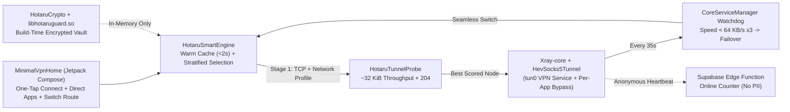

# معماری کلاینت اندروید و طراحی رابط کاربری HotaruNet

🌐 **زبان:** [🇬🇧 English](ARCHITECTURE.md) | **🇮🇷 فارسی (Persian)**

---

## ۱. جریان کلی عملکرد در اپلیکیشن اندروید

## ۲. ماژول‌های کلیدی کلاینت (`V2rayNG/app/src/main/`)

- **`ui/main/MinimalVpnHome.kt` و `HotaruDancingMascot.kt`**: رابط کاربری تک‌صفحه‌ای Void-Galaxy (Jetpack Compose) با انیمیشن ربات ۴ مرحله‌ای، شمارندهٔ دقیق ترافیک عبوری از پروکسی، انتخابگر **برنامه‌های مستقیم (Split Tunneling)**، دکمهٔ **تغییر مسیر آنی (Switch Route)**، تغییر آنی زبان (`FA / EN`)، بروزرسانی درون‌برنامه‌ای (`HotaruUpdateDialog`) و بخش درباره ما (`HotaruAboutDialog`).
- **`handler/HotaruSmartEngine.kt`**: تشخیص نوع شبکه کاربر (دیتا یا وای‌فای)، اولویت‌بندی پروتکل‌های ضد‌فیلتر (`REALITY`, `XHTTP`, `WS+TLS`, `Hysteria2`, `WARP`)، رتبه‌بندی بر اساس سرعت واقعی دانلود بدون محدودیت جغرافیایی و نگهداری کش گرم برای اتصال مجدد زیر ۲ ثانیه.
- **`core/HotaruHealthPolicy.kt` و `core/HotaruTunnelProbe.kt`**: اندازه‌گیری کم‌مصرف سرعت دانلود واقعی (`~32 KiB` با `Range` و تست اتصال تک‌CDN متناوب) و نگهبان زنده هر ۳۵ ثانیه؛ در صورت ۳ خطای متوالی یا افت سرعت زیر `64 KB/s` در ۳ نمونه پیاپی، انتقال خودکار و بدون قطعی کاربر به سرور سالم بعدی انجام می‌شود.
- **`service/QSTileService.kt`**: کاشی هوشمند Quick Settings برای اتصال مستقیم و خودکار بدون نیاز به باز کردن اپلیکیشن.
- **`handler/HotaruCommunityCounter.kt`**: نمایشگر ناشناس تعداد کاربران آنلاین با امضای HMAC روی Supabase Edge Functions + PostgreSQL بدون ذخیرهٔ هیچ دادهٔ هویتی یا ترافیکی.
- **`handler/UpdateCheckerManager.kt` و `handler/HotaruApkUpdater.kt`**: بررسی بی‌صدای آخرین ریلیز در `OneForAllHub/HotaruNet` هنگام باز شدن برنامه، دانلود مستقیم APK متناسب با معماری دستگاه درون برنامه و فراخوانی نصب‌کننده سیستم.
- **`util/HotaruCrypto.kt` و `cpp/hotaru_guard.cpp`**: محافظت از داده‌های حساس خارج از بایت‌کد DEX در لایهٔ نیتیو JNI و سخت‌سازی شبکه در `network_security_config.xml` (بستن گواهی‌های User CA و ترافیک غیررمزنشدهٔ غیراز لوپ‌بک).

---

> توجه: اسکریپت‌های سرور جمع‌آوری، لیست کانال‌ها و منابع، توکن‌ها و کلیدهای رمزنگاری واقعی در این مخزن نمایشی عمومی قرار داده نشده‌اند.

