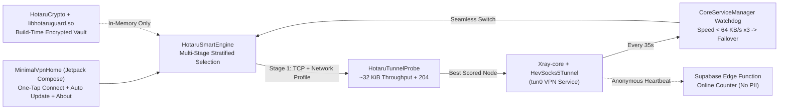

# HotaruNet Client Architecture & UI Design

🌐 **Language:** **English** | [🇮🇷 فارسی (Persian)](ARCHITECTURE.fa.md)

---

## 1. High-Level Android Flow

## 2. Key Modules (`V2rayNG/app/src/main/`)

- **`ui/main/MinimalVpnHome.kt`**: Single-screen Void-Galaxy Compose UI featuring neon animated connection controls, live upload/download traffic counters, online community badge, `FA / EN` instant switcher, silent launch release checker dialog (`HotaruUpdateDialog`), one-time first-connect welcome popup (`HotaruFirstConnectDialog`), and project info (`HotaruAboutDialog`).
- **`handler/HotaruSmartEngine.kt`**: Adapts DNS, fragment, and candidate priorities to active Cellular/Wi-Fi networks; validates real throughput across stratified protocol tiers (`REALITY_VISION`, `XHTTP`, `WS_TLS`, `HYSTERIA2`, `WARP_DEDICATED`) without geographic bias, using adaptive background harvest cadences (`30 min` when pool >= 40, `10 min` under sparse pools).
- **`core/HotaruHealthPolicy.kt` & `core/HotaruTunnelProbe.kt`**: Evaluates payload download throughput (`~32 KiB` HTTP `Range` checks, `35s` watchdog interval, alternating single-CDN connectivity probe) and triggers seamless in-place reload failover when failures reach `>= 3` or sustained speed drops below `64 KB/s` for `3` consecutive samples.
- **`handler/HotaruCommunityCounter.kt`**: Privacy-preserving aggregate online session indicator backed by HMAC-signed ephemeral installation heartbeats (60s cadence, 180s server TTL, instant leave on disconnect) on Supabase Edge Functions + PostgreSQL.
- **`handler/UpdateCheckerManager.kt`**: Queries `https://api.github.com/repos/OneForAllHub/HotaruNet/releases/latest` cleanly on launch (and after VPN connect if initially unreachable), compares semantic versions, and silently returns without UI interruption if no update is available.
- **`util/HotaruCrypto.kt` + `cpp/hotaru_guard.cpp`**: JNI native vault keeping AES keys and private subscription credentials outside Java/DEX bytecode (`network_security_config.xml` trusts system CAs only and disables non-loopback cleartext HTTP).

---

> Note: Private backend scrapers, proxy sources, encryption keys, and API tokens are excluded from this public showcase repository.
