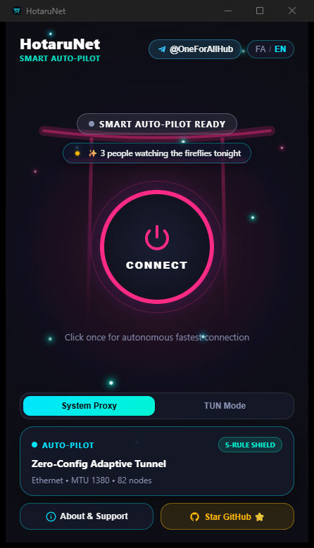
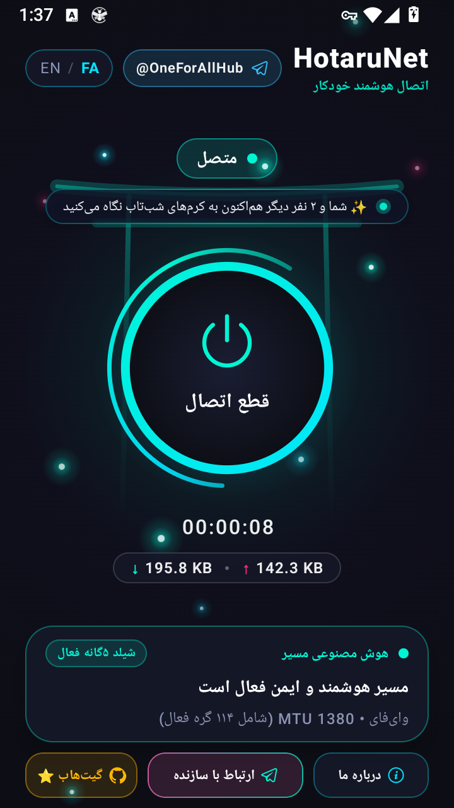
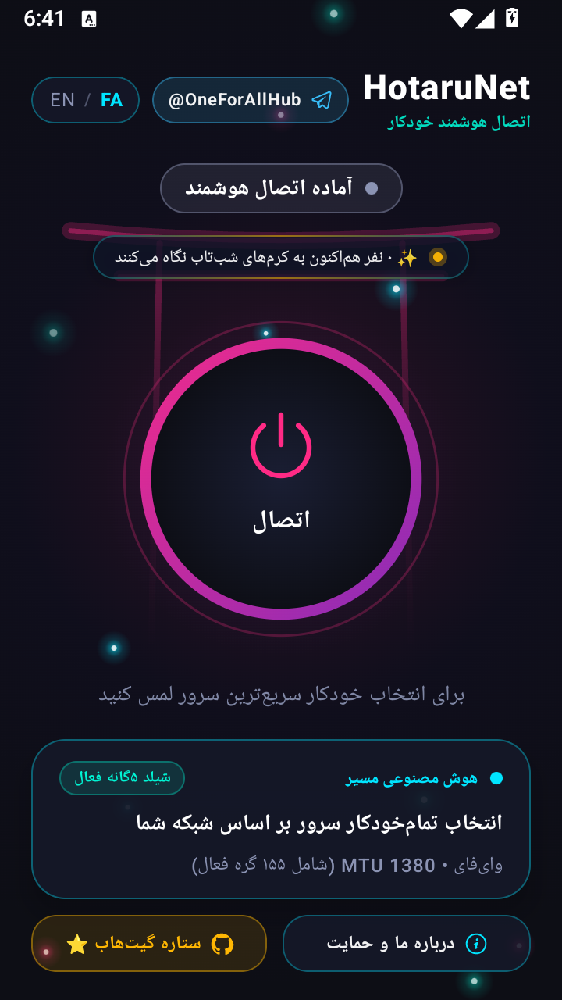
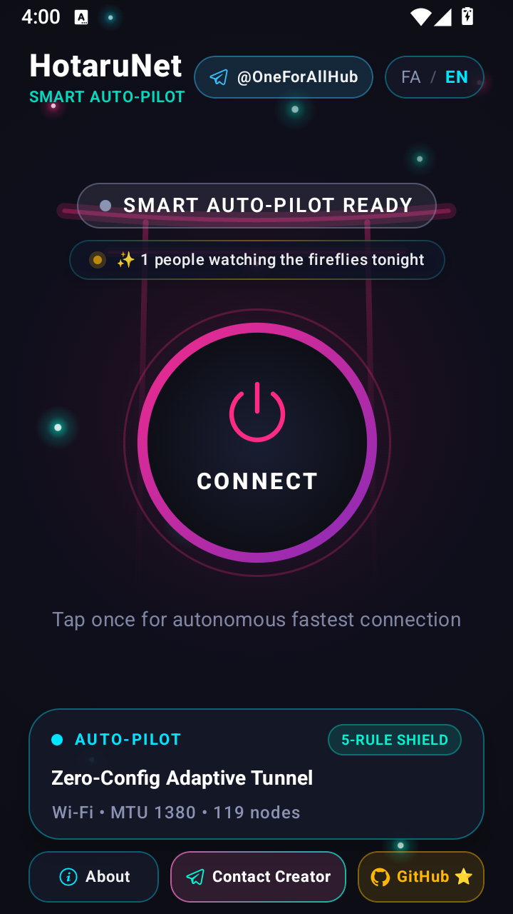
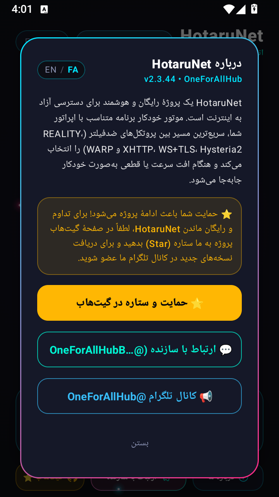
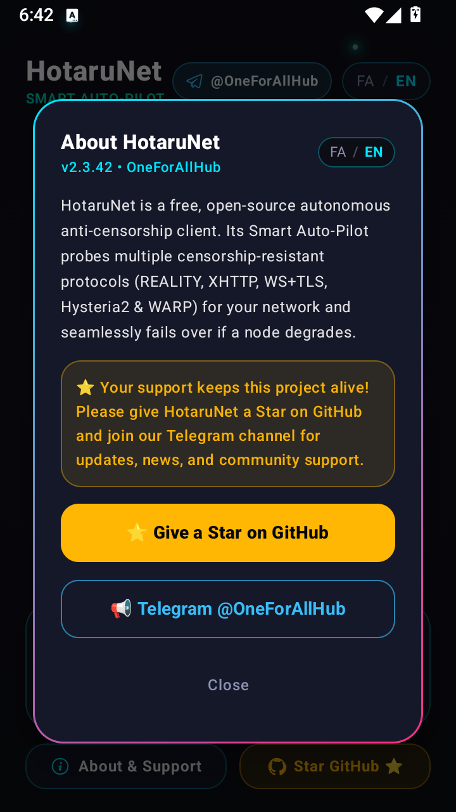



# ⚡ HotaruNet (هوتارو نت) — فیلترشکن هوشمند و رایگان اندروید و ویندوز

**کلاینت خودکار، پرسرعت، کم‌مصرف و بدون نیاز به کانفیگ برای اندروید و ویندوز ۱۰ و ۱۱**  
*(VLESS REALITY • Hysteria 2 • Cloudflare WARP • XHTTP / SplitHTTP • Xray-core • Wintun TUN)*

🌐 **زبان:** [🇬🇧 English](README.md) | **🇮🇷 فارسی (Persian)**

[-0078D6?style=for-the-badge&logo=windows)](https://github.com/OneForAllHub/HotaruNet/releases/latest)
[-3DDC84?style=for-the-badge&logo=android)](https://github.com/OneForAllHub/HotaruNet/releases/latest)

[📥 **دانلود مستقیم نسخه ویندوز**](#-دانلود-نسخه-ویندوز-کامپیوتر-و-لپتاپ) • [📥 **دانلود فایل نصبی اندروید (APK)**](#-دانلود-مستقیم-نسخه-اندروید-apk) • [📱 **تصاویر برنامه**](#-تصاویر-محیط-برنامه-فارسی-و-انگلیسی) • [✨ **امکانات**](#-ویژگی‌های-کلیدی-hotarunet) • [🔔 **سیستم اعلان آپدیت**](#-سیستم-اعلان-هوشمند-آپدیت-یکسان-با-اندروید) • [🏗️ **معماری**](ARCHITECTURE.fa.md) • [❓ **سوالات متداول**](#-سوالات-متداول-faq)

---

> ⭐ **حمایت از پروژه:** اگر HotaruNet به دسترسی آزاد، پایدار و پرسرعت شما کمک کرده است، لطفاً با **ستاره دادن (Star) به این مخزن در گیت‌هاب** و عضویت در کانال تلگرام **[@OneForAllHub](https://t.me/OneForAllHub)** از توسعهٔ مداوم و رایگان این پروژه حمایت کنید!

---

## 📥 دانلود مستقیم آخرین نسخه (`v2.3.43`)

HotaruNet به‌صورت کاملاً نیتیو هم برای **ویندوز (کامپیوتر و لپ‌تاپ)** و هم برای **اندروید (گوشی و تبلت)** در دسترس است — بدون نیاز به خرید اشتراک، وارد کردن دستی کانفیگ یا ساخت اکانت.

### 🪟 دانلود نسخه ویندوز (کامپیوتر و لپ‌تاپ)

کلاینت پرسرعت، کم‌حجم و بدون نیاز به نصب (Portable) با دو حالت اتصال: **پروکسی سیستم (System Proxy)** برای وب‌گردی آنی بدون نیاز به مجوز ادمین و **حالت TUN با درایور Wintun** برای تونل کل ترافیک سیستم (بازی‌ها، شبیه‌سازها، تلگرام دسکتاپ و خط فرمان).

| بسته دانلودی | سیستم‌عامل و معماری | حجم | مشخصات و کد اعتبارسنجی (SHA-256) |
| --- | --- | --- | --- |
| [**`HotaruNet_v2.3.43_windows_x64.zip`**](https://github.com/OneForAllHub/HotaruNet/releases/latest) | **ویندوز ۱۰ و ۱۱ (۶۴ بیتی)** | ~۴۳.۸ مگابایت | **نسخه پرتابل و آماده اجرا** (شامل نرم‌افزار اصلی `HotaruNet.exe`، سرویس پیشرفته TUN، کتابخانه بهینه‌شده Xray-core و درایور رسمی Wintun). `SHA-256: F3D7B1963BFC336BC3000A783C4AABDCD830656AB800D27C3364A8362C4AC6B4` |

#### 🚀 راهنمای سریع استفاده در ویندوز:
1. فایل [**`HotaruNet_v2.3.43_windows_x64.zip`**](https://github.com/OneForAllHub/HotaruNet/releases/latest) را دانلود و از حالت فشرده خارج (Extract) کنید.
2. روی فایل **`HotaruNet.exe`** کلیک کنید تا اجرا شود.
3. حالت دلخواه را انتخاب کنید:
   - **System Proxy (پیش‌فرض):** بدون نیاز به دسترسی Administrator فوراً متصل می‌شود و پروکسی سیستم را تنظیم و هنگام خروج ریست می‌کند.
   - **حالت TUN:** کارت شبکه مجازی امن ایجاد می‌کند تا کل ترافیک ویندوز از تونل رد شود. برای فعال‌سازی کافی است یک‌بار برنامه را با *Run as administrator* اجرا نمایید.
4. دکمهٔ دایره‌ای **اتصال (CONNECT)** را بزنید تا هوش مصنوعی مسیر بهترین سرور را انتخاب کند!

---

### 📱 دانلود مستقیم نسخه اندروید (APK)

فایل‌های نصبی رسمی و امضاشده (APK) مستقیماً از [**صفحه Releases گیت‌هاب**](https://github.com/OneForAllHub/HotaruNet/releases/latest):

| نام فایل APK | پردازنده / دستگاه هدف | پیشنهاد برای چه گوشی‌هایی؟ |
| --- | --- | --- |
| [`HotaruNet_2.3.43_arm64-v8a.apk`](https://github.com/OneForAllHub/HotaruNet/releases/latest) | **ARM64 (64 بیتی)** (~۲۶.۳ MB) | مناسب برای تمام گوشی‌های جدید سامسونگ، شیائومی و... (توصیه‌شده) |
| [`HotaruNet_2.3.43_armeabi-v7a.apk`](https://github.com/OneForAllHub/HotaruNet/releases/latest) | **ARMv7 (32 بیتی)** (~۲۶.۸ MB) | گوشی‌ها و تبلت‌های قدیمی‌تر |
| [`HotaruNet_2.3.43_x86_64.apk`](https://github.com/OneForAllHub/HotaruNet/releases/latest) | **x86_64** (~۲۷.۳ MB) | شبیه‌سازهای اندروید روی کامپیوتر و کروم‌بوک |
| [`HotaruNet_2.3.43_x86.apk`](https://github.com/OneForAllHub/HotaruNet/releases/latest) | **x86** (~۲۷.۸ MB) | شبیه‌سازهای ۳۲ بیتی |
| [`HotaruNet_2.3.43_universal.apk`](https://github.com/OneForAllHub/HotaruNet/releases/latest) | **همه‌کاره (Universal)** (~۶۴.۲ MB) | قابل نصب روی تمام دستگاه‌ها بدون نیاز به دانستن مدل CPU |

> 💡 هش SHA-256 همهٔ فایل‌ها در صفحهٔ [Releases](https://github.com/OneForAllHub/HotaruNet/releases/latest) قرار دارد و روی اندروید ۷ تا ۱۵ (API 24–35) پشتیبانی می‌شود.

---

## 🔔 سیستم اعلان هوشمند آپدیت (یکسان با اندروید)

در هر دو نسخهٔ **ویندوز و اندروید**، سیستم بررسی نسخه جدید به‌صورت هوشمند عمل می‌کند:
- **بررسی کاملاً بی‌صدا:** هنگام اجرای برنامه و ۱.۵ ثانیه پس از برقراری اتصال، نسخهٔ جدید در پس‌زمینه بدون مصرف پهنای باند اضافی چک می‌شود.
- **اعلان پنجره‌ای برجسته (Modal Dialog):** به محض اینکه نسخه جدیدی منتشر شود، دقیقاً مشابه اندروید، یک پنجرهٔ مدرن با نمایش تغییرات (`v2.3.43 ➔ v2.3.44`)، لیست بهبودها و دکمهٔ دریافت مستقیم نمایش داده می‌شود.
- تا زمانی که نسخهٔ شما به‌روز باشد، برنامه کاملاً ساکت و بدون مزاحمت عمل می‌کند.

---

## 📱 تصاویر محیط برنامه (فارسی و انگلیسی)

رابط کاربری هوتارو نت دارای دکمهٔ تغییر آنی زبان **`FA / EN`** است و به‌صورت کامل از چیدمان راست‌به‌چپ (**فارسی RTL**) و **انگلیسی (LTR)** در صفحه اصلی، وضعیت اتصال، ترافیک لحظه‌ای و بخش درباره ما پشتیبانی می‌کند:

<table align="center">
  <thead>
    <tr>
      <th align="center">🇮🇷 فارسی — وضعیت متصل</th>
      <th align="center">🇬🇧 English — وضعیت متصل</th>
      <th align="center">🇮🇷 فارسی — صفحه آماده اتصال</th>
      <th align="center">🇬🇧 English — صفحه آماده اتصال</th>
    </tr>
  </thead>
  <tbody>
    <tr>
      <td align="center"></td>
      <td align="center"></td>
      <td align="center"></td>
      <td align="center"></td>
    </tr>
  </tbody>
</table>

🖼️ مشاهدهٔ تصاویر بخش درباره ما و حمایت (فارسی / English)

 
<table align="center">
  <thead>
    <tr>
      <th align="center">🇮🇷 درباره ما و حمایت (فارسی)</th>
      <th align="center">🇬🇧 درباره ما و حمایت (انگلیسی)</th>
    </tr>
  </thead>
  <tbody>
    <tr>
      <td align="center"></td>
      <td align="center"></td>
    </tr>
  </tbody>
</table>

---

## ✨ ویژگی‌های کلیدی HotaruNet

HotaruNet با رابط کاربری اختصاصی و موتور هوشمند **Auto-Pilot** برای عبور پایدار از محدودیت‌های شبکه و اختلالات شدید اینترنت ایران (همراه اول، ایرانسل، رایتل، مخابرات، شاتل، زیتل، آسیاتک و فیبر نوری) طراحی شده است:

- **اتصال هوشمند تک‌کلیک بدون نیاز به کانفیگ:** نیازی به پیدا کردن کانفیگ روزانه یا وارد کردن لینک سابسکریپشن نیست؛ فقط دکمهٔ **اتصال** را بزنید تا برنامه با هوش مصنوعی و متناسب با اپراتور اینترنت شما بهترین کانکشن را فعال کند.
- **سنجش سرعت واقعی دانلود به‌جای پینگ خام:** پاسخ خالی `HTTP 204` یا پینگ میلی‌ثانیه‌ای معیار خوبی برای سرعت نیست؛ هوتارو نت سرعت واقعی دانلود دیتای ۳۲ کیلوبایتی را می‌سنجد و سرورها را بر اساس سرعت دانلود پایدار (`Bps`) اولویت‌بندی می‌کند.
- **شیلد ۵گانه پروتکل‌های ضد‌فیلتر مدرن:**
  1. **`VLESS + REALITY`** (پورت 443 با شناسه واقعی و جریان Vision)
  2. **`Cloudflare WARP Dedicated`** (ثبت کلید WireGuard اختصاصی و IPهای Anycast تمیز)
  3. **`Hysteria 2`** (پروتکل QUIC / UDP ضد‌اختلال با کنترل ازدحام BBR)
  4. **`XHTTP / SplitHTTP`** (مبتنی بر HTTP/2 و HTTP/3 مقاوم در برابر مسدودسازی)
  5. **`WebSocket + TLS`** (پشتیبان از طریق شبکه توزیع محتوا CDN)
- **دو حالت تونل‌سازی در ویندوز:**
  - **پروکسی سیستم (System Proxy):** تنظیم سریع پروکسی مرورگر با قابلیت پاکسازی و بازیابی خودکار ریجستری ویندوز هنگام بستن برنامه.
  - **کارت شبکه مجازی Wintun:** تونل‌سازی سراسری و فوق‌سریع در سطح هسته ویندوز برای تمام برنامه‌ها، بازی‌ها و ترمینال.
- **نگهبان زنده کم‌مصرف (Watchdog) و سوییچ خودکار:** در طول اتصال با حداقل حجم مصرفی (تست ۳۲ کیلوبایت هر ۳۵ ثانیه) کیفیت مسیر پایش می‌شود و در صورت افت سرعت (زیر ۶۴ کیلوبایت بر ثانیه) یا قطعی، برنامه خودکار و بدون قطعی کاربر را به سرور پرسرعت بعدی منتقل می‌کند.
- **بدون فیلتر ناعادلانه جغرافیایی:** سرورهای آمریکا، اروپا و آسیا صرفاً بر اساس سرعت و پایداری واقعی رقابت می‌کنند.

---

## 📚 مستندات پروژه (فارسی / English)

| سند | فارسی | English |
| --- | --- | --- |
| معرفی کامل و اسکرین‌شات‌ها | [README.fa.md](README.fa.md) | [README.md](README.md) |
| معماری کلاینت و موتور هوشمند | [ARCHITECTURE.fa.md](ARCHITECTURE.fa.md) | [ARCHITECTURE.md](ARCHITECTURE.md) |
| سیاست حفظ حریم خصوصی | [PRIVACY.fa.md](PRIVACY.fa.md) | [PRIVACY.md](PRIVACY.md) |
| خط‌مشی امنیت | [SECURITY.md](SECURITY.md) | [SECURITY.md](SECURITY.md) |

---

## ❓ سوالات متداول (FAQ)

<b>آیا نسخه ویندوز هنگام انتشار آپدیت به من اعلان می‌دهد؟</b>

بله، دقیقاً مشابه نسخه اندروید. هر دو نسخه به محض انتشار تگ جدید در گیت‌هاب، یک پنجرهٔ اختصاصی نمایش می‌دهند که تغییرات نسخه جدید و دکمهٔ دانلود مستقیم را در اختیارتان می‌گذارد.

<b>کدام نسخه ویندوز پشتیبانی می‌شود و چطور باید نصب کنم؟</b>

ویندوز ۱۰ و ۱۱ (نسخه‌های ۶۴ بیتی) پشتیبانی می‌شوند. برنامه کاملاً پرتابل است؛ فقط فایل زیپ را دانلود و استخراج کرده و <code>HotaruNet.exe</code> را اجرا کنید.

<b>تفاوت حالت System Proxy با TUN Mode در ویندوز چیست؟</b>

حالت پروکسی سیستم بدون نیاز به دسترسی ادمین بلافاصله مرورگرها و برنامه‌های سازگار با پروکسی سیستم را متصل می‌کند. حالت TUN یک کارت شبکه اختصاصی Wintun ایجاد کرده و کل ترافیک اینترنت کامپیوتر (از جمله بازی‌ها، ترمینال و سایر نرم‌افزارها) را از تونل رد می‌کند.

<b>آیا برای استفاده از هوتارو نت به لینک سابسکریپشن یا کانفیگ جداگانه نیاز دارم؟</b>

خیر! کافی است فایل زیپ ویندوز یا فایل APK اندروید را دانلود کنید، زبان را انتخاب کرده و دکمه اتصال را بزنید.

<b>آیا تست‌های پس‌زمینه حجم اینترنت زیادی مصرف می‌کنند؟</b>

خیر؛ تست سرعت زنده فقط با پیلود ۳۲ کیلوبایتی و هر ۳۵ ثانیه انجام می‌شود و زمان‌بندی رفرش پس‌زمینه به ۳۰ تا ۶۰ دقیقه بهینه‌سازی شده تا کمترین مصرف بسته اینترنت را داشته باشد.

<b>آیا هوتارو نت اطلاعات وب‌گردی کاربران را ذخیره می‌کند؟</b>

خیر؛ هیچ‌گونه لاگ از تاریخچه وب‌گردی، آی‌پی‌ها یا شناسه‌های سخت‌افزاری جمع‌آوری نمی‌شود (سند <a href="PRIVACY.fa.md">PRIVACY.fa.md</a> را بخوانید).

---

## 🔒 توضیح دربارهٔ مخزن عمومی (Showcase Source)

این مخزن عمومی شامل **طراحی رابط کاربری (UI)، معماری کلاینت اندروید و ویندوز، سرویس پیشرفته Wintun، الگوریتم هوشمند انتخاب مسیر و سازوکار امنیتی برنامه** است.

برای جلوگیری از مسدودسازی زیرساخت و حفظ امنیت کاربران:
- هیچ **سرور، کانفیگ، لینک سابسکریپشن یا آدرس سرور جمع‌آوری** در این مخزن عمومی قرار نگرفته است (`assets/subscription.dat` خالی است).
- هیچ **توکن، کلید رمزنگاری، کوکی، پسورد یا فایل کلید** در کدهای عمومی وجود ندارد و مقادیر حساس صرفاً هنگام بیلد رسمی در باینری‌های نیتیو محافظت‌شده تزریق می‌شوند.

---

## 📲 ارتباط و حمایت از پروژه

- **دانلود آخرین نسخه:** [صفحه Releases گیت‌هاب](https://github.com/OneForAllHub/HotaruNet/releases/latest)
- **کانال رسمی تلگرام:** [@OneForAllHub](https://t.me/OneForAllHub)
- **گزارش باگ و پیشنهادها:** [بخش Issues گیت‌هاب](https://github.com/OneForAllHub/HotaruNet/issues)

ساخته‌شده با Jetpack Compose و Tauri 2 بر پایهٔ هستهٔ متن‌باز Xray-core، درایور Wintun و [2dust/v2rayNG](https://github.com/2dust/v2rayNG) تحت مجوز GPL-3.0.

