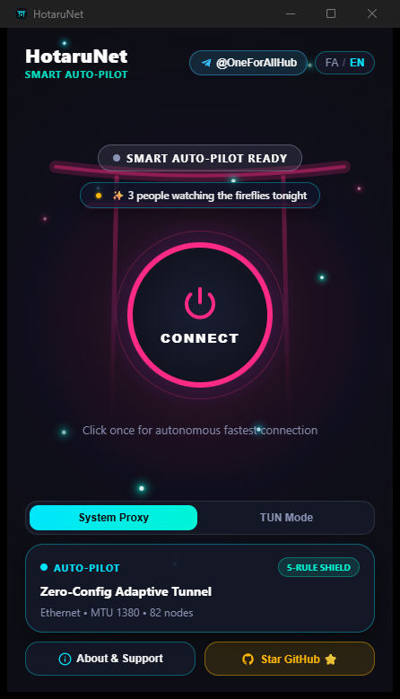
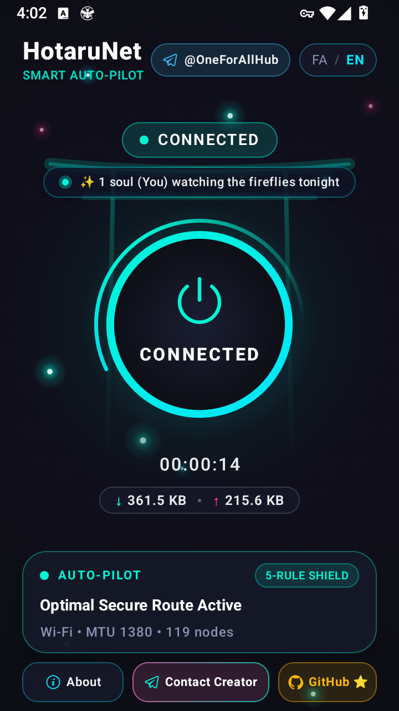
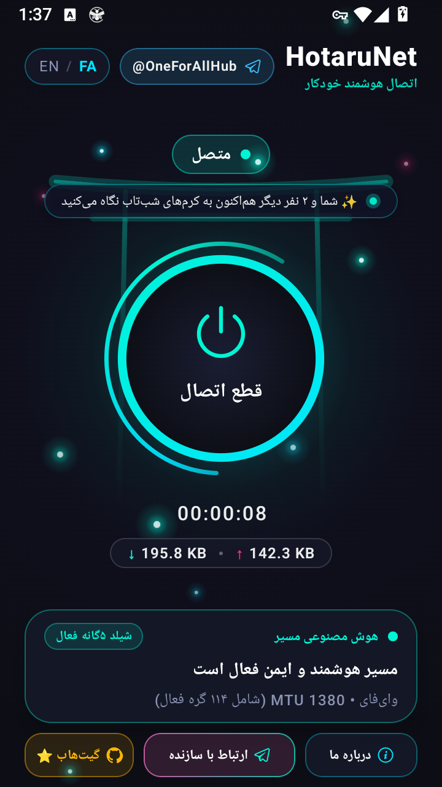
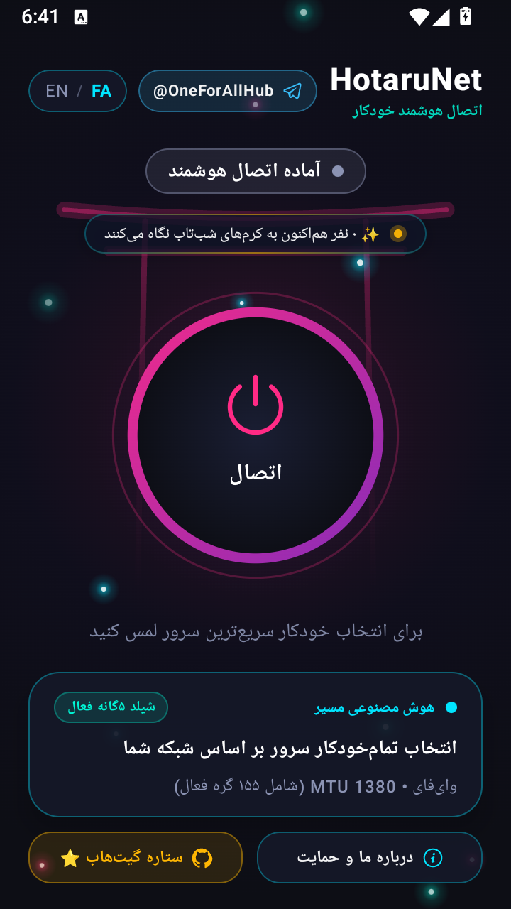
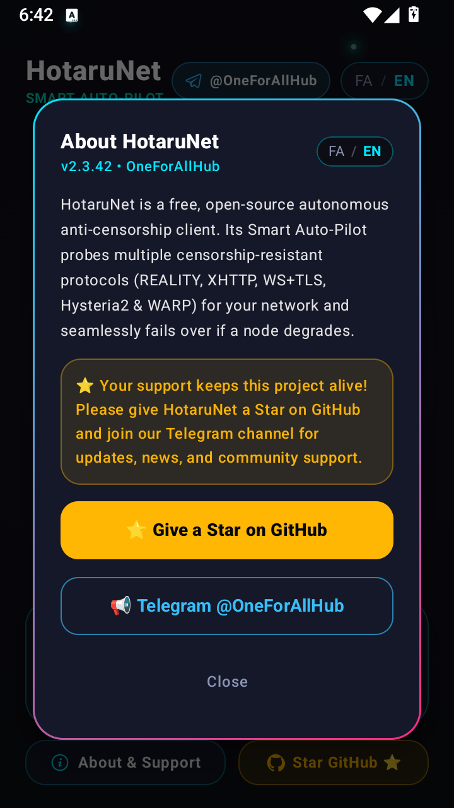
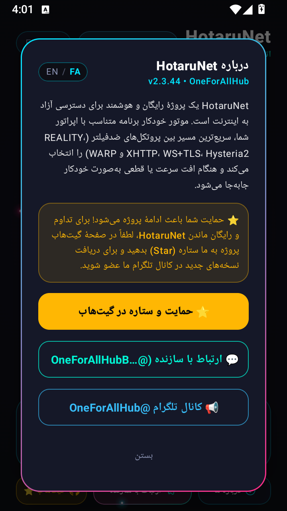



# ⚡ HotaruNet — Autonomous Android & Windows VPN Client

**Free, Open-Source, Zero-Config Anti-Censorship VPN Client for Android & Windows 10/11**  
*(VLESS REALITY • Hysteria 2 • Cloudflare WARP • XHTTP / SplitHTTP • Xray-core • Wintun TUN)*

🌐 **Language:** **English** | [🇮🇷 فارسی (Persian)](README.fa.md)

[-0078D6?style=for-the-badge&logo=windows)](https://github.com/OneForAllHub/HotaruNet/releases/latest)
[-3DDC84?style=for-the-badge&logo=android)](https://github.com/OneForAllHub/HotaruNet/releases/latest)

[📥 **Download for Windows**](#-download-for-windows-pc--laptop) • [📥 **Download APK for Android**](#-download-for-android-smartphones--tablets) • [📱 **UI & Screenshots**](#-screenshots--bilingual-ui) • [✨ **Features**](#-what-makes-hotarunet-different) • [🔔 **Update Alerts**](#-instant-release-notifications-android--windows-parity) • [🏗️ **Architecture**](ARCHITECTURE.md) • [❓ **FAQ**](#-frequently-asked-questions-faq)

---

> ⭐ **Support Open Internet Access:** If HotaruNet helps you stay connected reliably, please **Star this repository** on GitHub and join **[@OneForAllHub](https://t.me/OneForAllHub)** on Telegram for instant release alerts and updates.

---

## 📥 Download Latest Releases (`v2.3.43`)

HotaruNet is available natively for both **Windows (PC/Laptop)** and **Android**. No subscription URLs, manual config imports, or account registration needed.

### 🪟 Download for Windows (PC / Laptop)

High-performance portable client with both **System Proxy** (instant, unprivileged browser browsing) and **Wintun TUN Mode** (system-wide routing for games, terminal, apps).

| Release Package | Architecture & OS | Size | Description & SHA-256 Checksum |
| --- | --- | --- | --- |
| [**`HotaruNet_v2.3.43_windows_x64.zip`**](https://github.com/OneForAllHub/HotaruNet/releases/latest) | **Windows 10 / 11 (64-bit)** | ~43.8 MB | **Standalone Portable Archive** (Zero-Install). Includes `HotaruNet.exe`, privileged TUN service, obfuscated Xray-core DLL, and official Wintun driver. `SHA-256: F3D7B1963BFC336BC3000A783C4AABDCD830656AB800D27C3364A8362C4AC6B4` |

#### 🚀 Quick Start for Windows:
1. Download [**`HotaruNet_v2.3.43_windows_x64.zip`**](https://github.com/OneForAllHub/HotaruNet/releases/latest) and extract to any folder.
2. Run **`HotaruNet.exe`**.
3. Choose your mode:
   - **System Proxy Mode** (Default): Works immediately without Administrator rights. Automatically configures and restores Windows system proxy.
   - **TUN Mode**: Full virtual network adapter routing. Right-click `HotaruNet.exe` and select *Run as administrator* to enable system-wide Wintun routing.
4. Click **CONNECT** for autonomous zero-config routing!

---

### 📱 Download for Android (Smartphones & Tablets)

Official signed APK packages directly from [**GitHub Releases (Latest)**](https://github.com/OneForAllHub/HotaruNet/releases/latest):

| File Name | Target Devices / CPU Architecture | Recommended For |
| --- | --- | --- |
| [`HotaruNet_2.3.43_arm64-v8a.apk`](https://github.com/OneForAllHub/HotaruNet/releases/latest) | **ARM64 (64-bit)** (~26.3 MB) | Almost all modern Android smartphones (Recommended) |
| [`HotaruNet_2.3.43_armeabi-v7a.apk`](https://github.com/OneForAllHub/HotaruNet/releases/latest) | **ARMv7 (32-bit)** (~26.8 MB) | Older Android phones & tablets |
| [`HotaruNet_2.3.43_x86_64.apk`](https://github.com/OneForAllHub/HotaruNet/releases/latest) | **x86_64** (~27.3 MB) | Chromebooks & PC Android emulators |
| [`HotaruNet_2.3.43_x86.apk`](https://github.com/OneForAllHub/HotaruNet/releases/latest) | **x86** (~27.8 MB) | Legacy 32-bit x86 emulators |
| [`HotaruNet_2.3.43_universal.apk`](https://github.com/OneForAllHub/HotaruNet/releases/latest) | **Universal (All ABIs)** (~64.2 MB) | Unsure which CPU your phone uses |

> 💡 All release packages carry SHA-256 verification checksums on the [Releases page](https://github.com/OneForAllHub/HotaruNet/releases/latest) and work out-of-the-box on Android 7.0 through Android 15 (API 24–35).

---

## 🔔 Instant Release Notifications (Android & Windows Parity)

HotaruNet implements a unified silent update checker across both Android and Windows clients:
- **Silent Background Probing:** On launch and 1.5s after connection, HotaruNet checks GitHub releases quietly.
- **Prominent Update Dialog:** Whenever a new version is published, the app pops up an immediate Cyber-Anime modal displaying:
  - Exact version transition (`vCurrent ➔ vLatest`)
  - Formatted release notes and speed improvements
  - Direct 1-click download button opening GitHub Releases
  - Remind me later option
- Stays completely silent when you are already running the latest version.

---

## 📱 Screenshots — Bilingual UI (English & فارسی)

HotaruNet ships with an instant in-app **`FA / EN`** switcher supporting full **English (LTR)** and **Persian / فارسی (RTL)** layouts across every dialog, live traffic telemetry card, and status indicator.

<table align="center">
  <thead>
    <tr>
      <th align="center">🇬🇧 English — Connected VPN</th>
      <th align="center">🇮🇷 فارسی — وضعیت متصل</th>
      <th align="center">🇬🇧 English — Smart Home</th>
      <th align="center">🇮🇷 فارسی — صفحه اصلی</th>
    </tr>
  </thead>
  <tbody>
    <tr>
      <td align="center"></td>
      <td align="center"></td>
      <td align="center"></td>
      <td align="center"></td>
    </tr>
  </tbody>
</table>

🖼️ View About & Bilingual Support Screens (EN / فارسی)

 
<table align="center">
  <thead>
    <tr>
      <th align="center">🇬🇧 About & Support (English)</th>
      <th align="center">🇮🇷 درباره ما و حمایت (فارسی)</th>
    </tr>
  </thead>
  <tbody>
    <tr>
      <td align="center"></td>
      <td align="center"></td>
    </tr>
  </tbody>
</table>

---

## ✨ What Makes HotaruNet Different?

HotaruNet combines a **Zero-Config Cyber-Anime UI** with an **Autonomous Multi-Stage Auto-Pilot Engine** built specifically for high-DPI throttling networks, Iranian telecom carriers (MCI, MTN Irancell, Rightel, Shatel, Mokhaberat), and restricted environments:

- **One-Tap Zero-Config Auto-Pilot:** No broken public server lists, expired JSONs, or manual tweaking. Tap **CONNECT** and HotaruNet adapts MTU, fragment strategy, DNS, and server candidates to your active network (Wi-Fi, Cellular, ADSL, Fiber).
- **Real Download Throughput Over Empty Pings:** Instead of relying on raw TCP ping or empty `HTTP 204` responses, HotaruNet verifies sustained **~32 KiB** download throughput and scores nodes primarily on empirical bandwidth (`Bps`) combined with stability.
- **5-Protocol Anti-Censorship Shield:** Dynamically probes across stratified transports to route around ISP-specific throttling:
  1. **`VLESS + REALITY`** (TCP 443 + XTLS Vision flow)
  2. **`Cloudflare WARP Dedicated`** (per-device ephemeral WireGuard key registration + clean Anycast endpoints)
  3. **`Hysteria 2`** (QUIC / UDP congestion-controlled transport)
  4. **`XHTTP / SplitHTTP`** (HTTP/2 & HTTP/3 CDN-resilient transport)
  5. **`WebSocket + TLS`** (reverse-proxy fallback)
- **Dual Windows Routing Modes:**
  - **System Proxy Mode:** Fast HTTP/SOCKS system proxy toggle with safe automatic registry cleanup on exit.
  - **Wintun TUN Adapter Mode:** Full kernel-level network tunneling utilizing the official signed Wintun driver.
- **Lightweight Live Watchdog & Seamless Auto-Failover:** Checks tunnel health with minimal background data usage (`~32 KiB` HTTP Range checks every `35s`, single-CDN alternating checks). If throughput falls below `64 KB/s` for 3 consecutive samples or fails 3 times, HotaruNet silently switches to the next fastest route.
- **No Artificial Geographic Locks:** Nodes across North America, Europe, and Asia compete fairly on real measured throughput and stability rather than artificial country filters.

---

## 📚 Documentation (English / فارسی)

| Document | English | فارسی |
| --- | --- | --- |
| Project Overview & Screenshots | [README.md](README.md) | [README.fa.md](README.fa.md) |
| Client Architecture & Failover Engine | [ARCHITECTURE.md](ARCHITECTURE.md) | [ARCHITECTURE.fa.md](ARCHITECTURE.fa.md) |
| Privacy Policy (Zero-Log Architecture) | [PRIVACY.md](PRIVACY.md) | [PRIVACY.fa.md](PRIVACY.fa.md) |
| Security Policy | [SECURITY.md](SECURITY.md) | [SECURITY.md](SECURITY.md) |

---

## ❓ Frequently Asked Questions (FAQ)

<b>How do I use HotaruNet? Do I need a V2Ray subscription or config?</b>

No configuration is required. Install the APK on Android or extract the ZIP on Windows, launch the app, choose your language (English or فارسی), and tap <b>CONNECT</b>. The Smart Auto-Pilot handles discovery, throughput verification, and automatic failover for you.

<b>Does Windows notify me when an update is released?</b>

Yes, exactly like Android. Both clients check GitHub releases silently in the background and pop up a dedicated update notification modal whenever a new version is published.

<b>Which Windows version is supported?</b>

HotaruNet supports 64-bit Windows 10 and Windows 11. It operates with zero installation—just extract the zip and run <code>HotaruNet.exe</code>.

<b>Which APK file should I download for my Android phone?</b>

Most phones from the last 7+ years use <code>HotaruNet_2.3.43_arm64-v8a.apk</code> (~26 MB). If you are unsure or installing across multiple devices, choose <code>HotaruNet_2.3.43_universal.apk</code>.

<b>Does the background speed check waste mobile data?</b>

No. Watchdog throughput validation uses compact <code>32 KiB</code> HTTP Range probes every <code>35 seconds</code> while connected (~3.2 MB/hour) with alternating single-target reachability checks and reduced background refresh cadence when healthy.

<b>Does HotaruNet log browsing activity or personal data?</b>

Never. See <a href="PRIVACY.md">PRIVACY.md</a> — no browsing history, DNS queries, IPs, or hardware IDs are collected. Only an anonymous random session UUID is used for aggregate online user counts.

---

## 🔒 Public Showcase Repository Notice

This public repository publishes the **client UI, auto-pilot routing engine, health policy, failover state machine, Windows service & TUN adapter bindings, and cryptographic verification architecture**.

To protect infrastructure resilience and user security:
- **No servers, node URIs, or proxy configs** are committed (`assets/subscription.dat` is an empty placeholder).
- **No private feed URLs, API tokens, cookies, signing keystores, or telemetry credentials** are present in source control.
- Sensitive endpoints (`HOTARU_FEED_TOKEN`, `HOTARU_TELEMETRY_SECRET`, custom AES keys) are injected strictly at build time into compiled native binaries (`libhotaruguard.so` on Android and obfuscated Rust vault on Windows).

---

## 📲 Community & Credits

- **Official Releases:** [GitHub Releases](https://github.com/OneForAllHub/HotaruNet/releases/latest)
- **Telegram Community:** [@OneForAllHub](https://t.me/OneForAllHub)
- **Bug Reports & Feature Requests:** [GitHub Issues](https://github.com/OneForAllHub/HotaruNet/issues)

Built with Jetpack Compose & Tauri 2, grounded on open-source [Xray-core](https://github.com/XTLS/Xray-core), [Wintun](https://www.wintun.net), and [2dust/v2rayNG](https://github.com/2dust/v2rayNG) under GPL-3.0.
